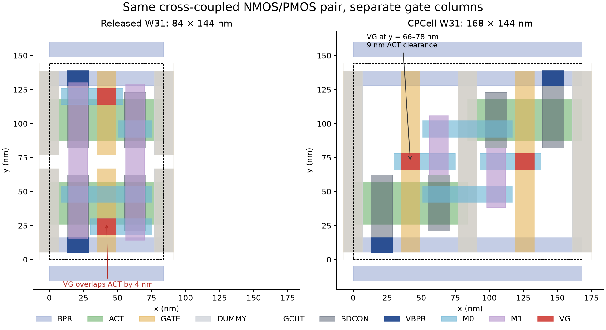

# CPCell W31 cross-coupled decap prototype

`gt2_6t_decapcc_cp_w31_{lvt,elvt,ulvt,svt,hvt}` preserves the released
`decapcc` circuit: one NMOS and one PMOS, both W=31 nm, L=14 nm, with each
drain connected to the other device's gate. The two external pins are `vdd`
and `vss`. Devices, threshold flavors, and supply/body connections match the
released four-terminal CDL.

The prototype is **168 × 144 nm**, twice the released cell's 84 × 144 nm area.
It puts the NMOS at x=42 nm and PMOS at x=126 nm, with disjoint active regions
and a full dummy gate between them. Both live gates are continuous through
the center of the cell. Their VG contacts occupy **y=66–78 nm**, leaving
**9 nm** to ACT, above the required 6 nm. No central gate cut is needed.
M1 stays at least 38 nm from either row boundary.

Source SDCONs extend to y=5 and 139 nm. Their VBPR contacts occupy y=5–16
and 128–139 nm, fully inside the 32 nm buried rails. Routing candidates use
the released 24 nm M0 grid: drain pads occupy y=42–54 and 90–102 nm, while
gate pads remain at y=66–78 nm. The LEF macro declares `CLASS CORE`, matching
the released decap.



This is a dedicated physical adapter for CPCellUCSD's `BandRouter`, using
the local `~/iv4/repos/CPCellUCSD` implementation. The adapter specifies
device placement, legal contact sites, and candidate routing edges. CP-SAT
chooses the cross-coupling wires and vias; the solution uses only M0/M1.
`OPTIMAL` refers to routing cost within this fixed placement and candidate
graph. It does not establish minimum possible cell width.

A subsequent [split-gate feasibility experiment](split_gate/README.md) uses
the new CPCell adapter to test the original 84 × 144 nm W31 frame. Both gate
contacts are inaccessible on the standard M0 tracks, giving `INFEASIBLE`
within that model. A taller 84 × 168 nm split-gate control passes the physical
checks but requires a different row height.

The same adapter now also produces a **126 × 144 nm staggered candidate**:
25% narrower than this prototype at the original row height. It uses adjacent
N/P gate columns and partial dummy markers. All five flavors pass the same
standalone, mirrored-array, and mixed-inverter DRC/LVS checks. See the
[narrower-cell results](split_gate/README.md); the electrical figures below
continue to describe the 168 nm prototype.

## Verification

All five threshold flavors pass transistor LVS against the **released GT2N
schematic**, independently of the generated CDL. For each flavor, checks cover:

- The individual cell.
- A 3×3 array with mirrored rows and alternating horizontal orientations.
- Three mirrored rows of released inverter / new decap / released inverter.

All 15 full DRC runs report only the two known `GATE.2` markers at the outer
edges of the gate array. The verifier checks their coordinates explicitly;
it rejects internal pitch errors or any other marker. All 15 LVS comparisons
pass, including the array top circuits and their constituent cells.

Additional library-compatibility checks require full VBPR containment in
BPR and SDCON, the released VBPR vertical positions, 12 nm M0 rectangles
centered on the 24 nm track grid, and LEF `CLASS CORE`. These checks reject
the earlier off-rail vias, off-grid drain pads, and `CORE SPACER` declaration,
which are not covered by the DRC deck.

The archived KLayout DRC deck adds `vg.interacting(act)` to detect VG/ACT
overlap and touching, following [PR #23](https://github.com/azadnaeemi/GT2N/pull/23).
`drc_use_nets=1` applies the original ICV `SDCON.2` different-net rule to
neighboring supply contacts. This matters for the released inverters in the
mixed array. The 5 nm SDCON/ACT enclosure matches the ICV source rule.

See [checks.json](w31/checks.json) for all results and artifact hashes,
[solution.json](w31/solution.json) for the selected routes and CPCell source
hashes, and each flavor directory for GDS, LEF, CDL, extraction, and DRC/LVS
databases. `reference.cdl` comes from the released library. `cell.cdl` comes
from the generator.

These are experimental physical views. [Electrical characterization](electrical/README.md)
now includes FasterCap partial wiring extraction and Xyce capacitance,
frequency-response, and model leakage sweeps for all five flavors. At TT,
0.7 V, 25 °C, the LVT cell gives about **0.297 fF**, including extracted wiring.
Physical leakage remains undetermined because the supplied transistor cards
disable gate tunneling and GIDL. The report documents extraction omissions
and the BSIM-CMG model adaptation; these results are not signoff.

ICV has not been run. The footprint has doubled, so this cell requires new
placement and its own library entry. No Liberty or Virtuoso view is supplied.

## Reproduce

From the GT2N root, using the existing CPCell environment:

```bash
PYTHONDONTWRITEBYTECODE=1 ../CPCellUCSD/.venv/bin/python \
  experimental/cpcell/decapcc/reproduce.py \
  --cpcell-root ../CPCellUCSD \
  --output-dir experimental/cpcell/decapcc/w31 \
  --vt lvt elvt ulvt svt hvt

PYTHONDONTWRITEBYTECODE=1 ../CPCellUCSD/.venv/bin/python \
  experimental/cpcell/decapcc/verify.py \
  --output-dir experimental/cpcell/decapcc/w31

PYTHONDONTWRITEBYTECODE=1 ../CPCellUCSD/.venv/bin/python \
  experimental/cpcell/decapcc/preview.py \
  --output-dir experimental/cpcell/decapcc/w31
```

Verification requires `klayout` on PATH and the archived DRC/LVS source decks
under `experimental/cpcell/w31_lvt/verification/decks`. The output contains
the exact deck copies used for checking. Read `checks.json` only after a
successful verification run; regeneration invalidates previous check results.

## PR #23 review

Reviewed commit `0209214c683a249d47effb8544efe1caeb931b90` using the matching
local `GT2N-decap` checkout. No blocking issue was found in the scoped W13
geometry change. Polygon comparison across all five W13 GDS libraries found
changes only in the decap cell, on VG, V0, M0, and M1, consistent with the PR.
The LEF obstruction edits match the changed metal rectangles.

All five patched W13 decaps pass transistor LVS and report only the two
outer-edge `GATE.2` markers in the KLayout port. Control runs reproduce two
`VG.ACT.1` errors on the original W13 cell and two `VG.ACT.1a` overlap errors
on the original W31 cell. Results and polygon differences are recorded in
[pr23-review.json](pr23-review.json). ICV was not run.

The W31 conflict described in [issue #22](https://github.com/azadnaeemi/GT2N/issues/22)
is real for the original topology's placement: moving VG outward to clear
ACT pushes its enclosing M1 too close to a mirrored neighboring row. This
prototype resolves it by assigning each transistor its own gate column.
PR #23's dependency on PR #21 and its unchanged Virtuoso views remain as
documented in that PR.
