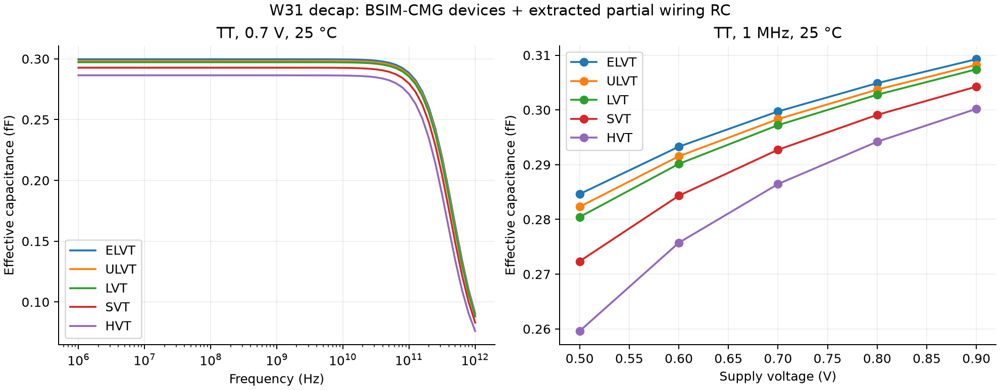

# W31 decap electrical characterization

Characterized the generated 168 × 144 nm cell with **FasterCap and Xyce**, without
ICV. Results combine BSIM-CMG device capacitance with **partial layout-extracted
wiring RC**. They are an engineering estimate, not a complete foundry PEX result.

These results use the corrected geometry: VBPR fully on BPR at y=5–16 and
128–139 nm, source SDCON extended to those contacts, and drain M0 pads
centered on the 48/96 nm tracks. Extraction and every sweep were rerun after
these changes; they supersede the earlier 0.2961 fF nominal LVT result.

## Results

TT, VDD = 0.7 V, temperature = 25 °C. Effective capacitance is
`Im(Y)/(2πf)` and equivalent series resistance is `Re(1/Y)`, measured at VDD
with VSS grounded. Area is 0.024192 µm².

| Flavor | Device-only C, 1 MHz (fF) | Partial PEX C, 1 GHz (fF) | Partial PEX C, 100 GHz (fF) | ESR, 1 GHz (Ω) |
| --- | ---: | ---: | ---: | ---: |
| ELVT | 0.2530 | 0.2997 | 0.2884 | 972 |
| ULVT | 0.2516 | 0.2983 | 0.2868 | 990 |
| LVT | 0.2505 | 0.2972 | 0.2854 | 1006 |
| SVT | 0.2460 | 0.2927 | 0.2797 | 1085 |
| HVT | 0.2397 | 0.2865 | 0.2710 | 1225 |

For LVT, the extracted wiring adds **0.0467 fF**, about 18.7% over the
device-only result. Capacitance density is **12.29 fF/µm²** at 1 GHz;
capacitance at 10 GHz is 0.2971 fF. The device-only column is the same
two-transistor circuit with ideal wires, not extraction of the released cell.

Sweeps cover 100 TT operating points: five flavors, 0.5–0.9 V in 0.1 V
steps, and −40, 25, 85, 125 °C. Each point includes 61 frequencies from
1 MHz to 1 THz. Another 20 runs vary GMIN at 0.7 V and 25/125 °C. Across
the 100 operating points, 1 MHz capacitance ranges from 0.2596 to 0.3116 fF.
The sweep range is exploratory and does not establish qualified operating
limits. The high-frequency tail is a quasistatic RC/model extrapolation;
there is no inductance or validation of device behavior at 1 THz.



## Leakage: physical value unavailable from these cards

All supplied W31 TT N/P cards set `IGCMOD=0`, `IGBMOD=0`, and `GIDLMOD=0`.
These switches disable gate tunneling and gate-induced drain leakage, as
documented in the [BSIM-CMG model controllers](https://bsim.gitbooks.io/bsimcmg/content/Ch7.2.html).
In this cross-coupled circuit the settled internal nodes are `net7=0` and
`net12=VDD`; both transistors have zero DC drain-source voltage. Consequently,
these models predict effectively zero supply current.

The largest absolute signed DC residual across all 120 runs and both circuit
variants was **1.5 × 10⁻²² A**. This is numerical residue, **not a physical
leakage estimate or upper bound**. GMIN was checked at 10⁻¹², 10⁻¹⁵, and
10⁻¹⁸ S at the selected temperatures. The analytic control correctly measured
0.7 pA through a known 1 TΩ resistor, so the measurement can resolve nonzero
leakage when the circuit contains it.

A defensible physical leakage number requires calibrated GT2N gate-current
models or measured/TCAD gate-current data. Simply enabling the disabled
switches would not supply that calibration.

## Extraction and model assumptions

- Connectivity and device terminals come from the verified LVT KLayout LVS
  database. All five flavors have identical physical conductor geometry;
  only device models and threshold markers differ.
- FasterCap solves the four-net Maxwell capacitance matrix for actual
  **M0, V0, M1, and buried power rail (BPR)** geometry. Touching conductor
  solids have their internal faces removed. Nanometer geometry is converted
  to SI capacitance after solving.
- Metal heights and dielectric constants come from `qrc/GT2.ict`; resistance
  and BPR thickness come from `nxtgrd/GT2.itf`. BPR is assumed to extend from
  −113 to −23 nm, below the 23 nm BOX. Dielectric interfaces at 0 and 98 nm
  separate relative permittivities 3.9, 7.0, and 2.4. The finite interface
  planes extend 800 nm beyond the conductor bounds.
- A 7 nm resistance mesh represents GATE/SDCON/BPR/M0/M1 sheet resistance.
  VG/VSD/V0/VBPR contact resistances scale with actual contact area. The
  resulting network has 506 nodes and 818 resistors. External supply ports
  are at the centers of the BPR polygons.
- Wiring capacitance is lumped once per electrical net, at its representative
  M1 node or supply port; it is not distributed over the resistance mesh.
  Matrix row-sum capacitance to the far-field reference is tied to VSS.
- BSIM-CMG supplies intrinsic, overlap, and fringe device capacitance.
  **Additional FEOL and VG/VSD/VBPR capacitance, diffusion spreading resistance,
  neighboring cells, and the chip/package environment are excluded.** Their
  effects cannot be bounded by the numerical convergence check. Wiring R/C
  is held constant with temperature; device temperature dependence is active.
- The source HSPICE cards specify BSIM-CMG 111, level 72. Xyce uses its
  native BSIM-CMG 110 implementation, level 110. Unsupported `VERSION`,
  `CAPMOD`, `COREMOD`, and `PRWG` parameters are omitted and recorded in
  [models.json](simulation/models.json). Other numeric model parameters are
  preserved, including `NFIN=3`, `HFIN=31 nm`, and `TFIN=5 nm`; extracted
  channel length is 14 nm. This adaptation has not been cross-validated
  against HSPICE 111. All simulations use TT cards.

## Numerical checks

All simulations completed with finite data and no unrecognized-parameter
warnings. `.OPTIONS DEVICE TEMP=...` sets the actual Xyce device temperature.
Source geometry hashes match the physical-verification artifacts.

The final refinement used a 3.5 nm resistance mesh, 1600 nm dielectric margin,
and FasterCap tolerance 0.001 instead of 0.005. At the nominal LVT bias:

- 1 MHz capacitance changed from **0.297218 to 0.297868 fF**.
- The maximum relative capacitance change through 100 GHz was **0.2182%**.
- 1 GHz ESR changed from **1006.35 to 1010.01 Ω**.
- The Maxwell matrix independently predicts the 0.0467473 fF low-frequency
  wiring contribution observed in the circuit simulation.

The known 1 fF / 1 kΩ series RC control, with a parallel 1 TΩ leakage path,
agreed with analytic complex admittance to a maximum relative error of
5.6 × 10⁻¹². These checks establish numerical consistency within the stated
model, not physical extraction accuracy.

## Artifacts and reproduction

- [characterization.json](simulation/characterization.json): all sweeps,
  nominal summaries, and source hashes. `simulation/benches/` retains the
  actual decks, raw AC/DC CSV data, and per-run results.
- [extraction.json](pex/extraction.json): technology values, extracted
  matrix/resistors, device mapping, scope, and input hashes.
  [rc.cir](pex/rc.cir) and [ideal.cir](pex/ideal.cir) are the circuit variants.
- [validation.json](validation.json), [analytic control](calibration/checks.json),
  and `convergence/` retain the numerical checks. The copied refined bench
  preserves its original `/tmp` include path; regenerate it with the command
  below when replaying elsewhere.

Used FasterCap 6.0.7 and Xyce
`DEVELOPMENT-202608061720-(Release-7.10.0-182-gd72b5846)-opensource`.
Put `FasterCap` and `Xyce` on PATH. Python needs KLayout, NumPy, and Matplotlib;
the local CPCellUCSD environment contains them. From the GT2N root:

```bash
PYTHONDONTWRITEBYTECODE=1 ../CPCellUCSD/.venv/bin/python \
  experimental/cpcell/decapcc/pex.py \
  --output-dir experimental/cpcell/decapcc/electrical/pex \
  --margin-nm 800 --mesh-nm 7 --error 0.005

PYTHONDONTWRITEBYTECODE=1 ../CPCellUCSD/.venv/bin/python \
  experimental/cpcell/decapcc/characterize.py \
  --pex-dir experimental/cpcell/decapcc/electrical/pex \
  --output-dir experimental/cpcell/decapcc/electrical/simulation

PYTHONDONTWRITEBYTECODE=1 ../CPCellUCSD/.venv/bin/python \
  experimental/cpcell/decapcc/pex.py \
  --output-dir experimental/cpcell/decapcc/electrical/convergence/tight1600 \
  --margin-nm 1600 --mesh-nm 3.5 --error 0.001

PYTHONDONTWRITEBYTECODE=1 ../CPCellUCSD/.venv/bin/python \
  experimental/cpcell/decapcc/characterize.py --smoke \
  --pex-dir experimental/cpcell/decapcc/electrical/convergence/tight1600 \
  --output-dir /tmp/decap-characterization/fine_smoke
```

Xyce's MPI build requires local sockets and may need to run outside a socket
sandbox. Regenerating geometry or changing device cards invalidates archived
electrical results; rerun extraction and characterization before using them.
