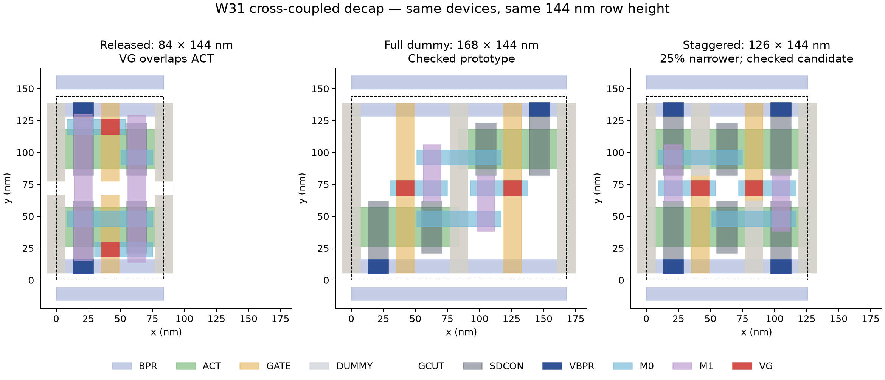

# CPCell split-gate feasibility results

CPCell now has a `SplitGateDecapProblem` adapter, GDS/CDL/LEF export, a
reproduction CLI, physical verifier, and regression tests. It derives the
separate gate conductors from GATE/GCUT/DUMMY geometry, filters contact sites
against ACT and GCUT, and retains inaccessible terminals in the solver.

**A 126 × 144 nm W31 candidate is feasible**, preserving the original row
height and standard M0 grid. It is 25% narrower than the earlier 168 nm
prototype. CPCell reproduces it with `--arrangement staggered`.

| Case | Arrangement | M0 track centers (nm) | Solver | Physical verification |
| --- | --- | --- | --- | --- |
| W31, 84 × 144 nm | Split | 24, 48, 72, 96, 120 | INFEASIBLE | No layout to check |
| W31, 84 × 168 nm | Split | 24, 48, 72, 96, 120, 144 | OPTIMAL | Standalone + mirrored array |
| W13, 84 × 144 nm | Split | 23, 48, 96, 121 | OPTIMAL | Standalone + mirrored array |
| **W31, 126 × 144 nm** | **Staggered** | **24, 48, 72, 96, 120** | **OPTIMAL** | **All 5 flavors: standalone + mirrored array + mixed inverter rows** |



The narrower candidate places the NMOS at x=42 and PMOS at x=84 nm. Both
ACT bands span the full 126 nm, as in every released multi-pitch cell: the
released one-pitch tap and filler carry only 42 nm of active and meet ACT.2
by merging with their neighbours, so a cell whose active stops short of an
edge leaves them an isolated 42 nm piece at a row end (an earlier revision
with ACT at x=0–84 / 42–126 nm did exactly that in the `aes` fill, 426
ACT.2 markers). Each gate crosses the other device's band as a tied-off
isolation gate under a partial dummy marker (y=82–144 nm on the NMOS gate,
y=0–62 nm on the PMOS gate, 4 nm clear of the gate contacts), as gate x=84
does in the released mux2; it is held at the supply that keeps that parasitic
transistor off, and the diffusion beyond it is contacted and tied to the same
rail, so nothing floats. Both gate contacts fit at y=66–78 nm, 9 nm from
ACT; no middle gate cut is needed. It has two
adjacent active gate columns and three 42 nm pitches across its boundary. It
does **not** solve the original one-column split-gate placement. The 84 nm
frame is infeasible for this schematic (the shared gate column needs the
middle cut, which leaves no legal gate-contact site), and cell widths are
site multiples, so 126 nm is the narrowest legal footprint; the 168 nm figure
is simply the earlier full-dummy prototype.

The cell is exported as `gt2_6t_decapcc_sg_w31_<vt>`, following the released
`gt2_6t_<cell>_w<sheet>_<vt>` naming, so it can sit beside the released
`gt2_6t_decapcc_w31_<vt>` in the same library files.

All four VBPR sit at y=5–16 and 128–139 nm, fully contained in BPR and
SDCON. Drain M0 pads are centered at 48/96 nm and gate pads at 72 nm. LEF
uses `CLASS CORE`, `SITE gt2_6t`, `FOREIGN` (as every released macro does),
and `SIZE 0.126 BY 0.144`. M0 pads stop 9 nm from the cell edge; the released
library's minimum is 8.5 nm, so any abutment keeps the 17 nm M0.4 gap.

At the original W31 footprint, both gate terminals have zero legal VG sites.
The outer/default tracks collide with ACT or lack its 6 nm clearance; the
middle track intersects the gate cut. All four N/P diffusion orientations
are covered by regression tests and remain infeasible. This is a result for
the specified frame and track grid, not a proof over arbitrary placements.

The taller W31 control shows that split gates can be routed and exported.
Its height is incompatible with the released 144 nm rows, and it does not
declare the `gt2_6t` LEF site. The W13 control explicitly uses shifted outer
tracks, like the contact movement in PR #23; it is not on the standard grid.

Physical verification uses the existing KLayout deck with the VG/ACT overlap
guard and LVS against the released four-terminal CDL. Each DRC run has only
the two known outer-edge `GATE.2` markers, checked by coordinates. Arrays are
3×3 with mirrored rows and alternating horizontal orientations. No ICV or
electrical characterization was run on the two split-gate control layouts.
The 126 nm candidate additionally passes all 20 released-CDL LVS comparisons
and all 20 DRC checks (with only the specified outer-edge markers) across
five flavors and four contexts: standalone, the 3×3 array, mixed inverter
rows, and rows that start and end in the released one-pitch tap with a
one-pitch filler mid-row. Geometry checks confirm rail containment,
M0 track alignment and LEF class for every flavor. See
[the combined checks](w31_126x144/checks.json), rebuilt from the per-flavor
results by [collect_checks.py](collect_checks.py).

## Nominal electrical comparison

The 126 nm LVT candidate was re-extracted from its own verified layout.
At TT, 0.7 V, 25 °C and 1 GHz, the same partial FasterCap/Xyce flow gives:

| Layout | Area (µm²) | Capacitance (fF) | Density (fF/µm²) |
| --- | ---: | ---: | ---: |
| Earlier 168 × 144 nm | 0.024192 | 0.2972 | 12.29 |
| New 126 × 144 nm | 0.018144 | 0.2891 | 15.93 |

This is 2.7% less capacitance in 25% less area, or 29.7% higher capacitance
density within the extraction model. An LVT sweep over 0.5–0.9 V and −40 to
125 °C (20 TT points) spans 0.2699 to 0.3017 fF at 1 MHz; other flavors
have not been characterized for this layout. Physical leakage remains unknown
because the supplied cards disable gate tunneling and GIDL. See
[electrical scope and results](w31_126x144/electrical/README.md).

## ORFS fill run

The cell was added to the local ORFS gt2n platform collateral as
`gt2_6t_decapcc_sg_w31_<vt>` (GDS cell, LEF macro with the Vt implant
obstruction, and a liberty entry cloned from the released decap with the new
area) by the platform's `add_decapcc_sg.py`, and `FILL_CELLS` was switched to
it for the 31 nm sheet; the 13 nm-sheet decap stays in the list for the
two-site gaps. The `aes` design (variant `sgdecap2`) completed with every PPA
metric identical to the previous run (`vgact`): worst slack −31.793 ps, TNS
−419.1 ps, 47.19 mW, 37,763 µm of wire, 137,833 vias, zero route DRC. Only
the fill changed:

| Fill cell | `vgact` | `sgdecap2` |
| --- | ---: | ---: |
| 31 nm-sheet decap (released 84 nm / staggered 126 nm) | 73,049 | 46,649 |
| 13 nm-sheet decap, 84 nm | 0 | 3,821 |
| 42 nm filler | 6,365 | 4,874 |
| decap area (µm²) | 883.6 | 892.6 |

The staggered count equals the greedy estimate from the previous fill runs.
Each cell holds the same two devices as the released decap, so the design
keeps about 64% of the released 31 nm-sheet decap devices (plus the 13 nm
decaps) in slightly more decap area. On the merged GDS, gdscheck's main
suite is clean and a chip-level KLayout check for VG shapes overlapping or
touching ACT reports none; the `vgact` GDS had the ten markers of the
released 31 nm decap (two gate contacts in each of five flavors). The first
run with this cell (variant `sgdecap`, ACT stopping at x=84 / 42) had the
same PPA and fill counts but 426 ACT.2 markers, every one a one-pitch tap at
a row end beside the decap's open side; the full-width active fixed it.

## Reproduce the narrower candidate

From the GT2N checkout:

```sh
PYTHONDONTWRITEBYTECODE=1 ../CPCellUCSD/.venv/bin/python \
  ../CPCellUCSD/examples/gt2n_split_gate/reproduce.py \
  --arrangement staggered --vt lvt \
  --output-dir experimental/cpcell/decapcc/split_gate/w31_126x144/lvt

PYTHONDONTWRITEBYTECODE=1 ../CPCellUCSD/.venv/bin/python \
  ../CPCellUCSD/examples/gt2n_split_gate/verify.py \
  --output-dir experimental/cpcell/decapcc/split_gate/w31_126x144/lvt \
  --pdk-root . \
  --drc-deck experimental/cpcell/decapcc/w31/decks/gt2n_overlap.lydrc \
  --lvs-deck experimental/cpcell/decapcc/w31/decks/gt2n_transistor.lylvs
```

Repeat with `elvt`, `ulvt`, `svt`, and `hvt` for the other threshold flavors.
Regeneration invalidates previous verification and electrical hashes.

## Files

- [Original-footprint contact diagnostics](w31_84x144/solution.json).
- [Taller W31 verification](w31_84x168/checks.json).
- [Shifted-track W13 verification](w13_84x144_shifted/checks.json).
- [Narrower W31 physical checks](w31_126x144/checks.json), [LVT GDS](w31_126x144/lvt/cell.gds), and [LEF](w31_126x144/lvt/cell.lef).
- [Initial CPCell patch](cpcell-split-gate.patch), [staggered update](cpcell-staggered-update.patch), [library conventions update](cpcell-library-conventions.patch) (released naming, `FOREIGN`, dummy markers 4 nm from the contacts), and [installed implementation hashes](implementation.json).
- [CPCell usage and API documentation](../../../../../CPCellUCSD/docs/gt2n_split_gate.md).

The related Python regression suite (split-gate, band matching, constraints,
thin-cell and unequal-row tests) passed **52 tests**, including the 28
split-gate tests, which now also check the released naming, the `FOREIGN`
line and the 4 nm dummy-marker clearance. The three patches are installed in
the local CPCell checkout. Existing
`BandRouter.solve()` behavior is preserved; the new `solve_result()` API
distinguishes infeasibility from a timeout without relying on exception text.
