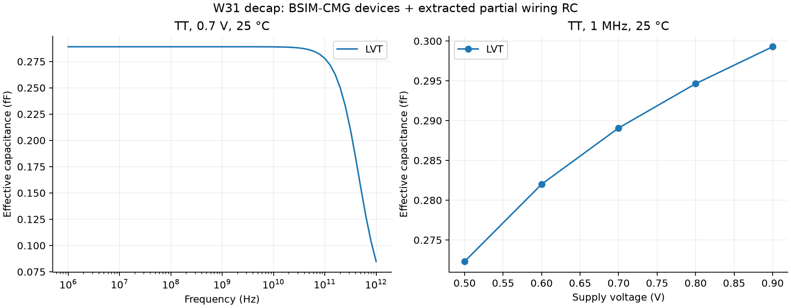

# 126 × 144 nm staggered W31 decap: nominal electrical result

The LVT layout was independently extracted from `../lvt/cell.gds` and its
passing transistor LVS database. Both active bands span the cell and the
diffusion beyond each isolation gate is tied to its rail; the two parasitic
off transistors under the isolation gates are not in the BSIM-CMG model, so
their gate capacitance is not counted. FasterCap solves M0/V0/M1/BPR capacitance;
the resistor network includes GATE, SDCON, routing, rails, and contacts.
The extraction has 464 nodes and 742 resistors. Settings: 800 nm dielectric
margin, 7 nm resistance mesh, FasterCap tolerance 0.005.

Xyce evaluated the extracted circuit at **TT, 0.7 V, 25 °C**, with 61 frequency
points from 1 MHz to 1 THz. Nominal results:

| Quantity | Value |
| --- | ---: |
| Device-only capacitance, 1 MHz | 0.250471 fF |
| Partial PEX capacitance, 1 MHz | 0.289073 fF |
| Partial PEX capacitance, 1 GHz | 0.289072 fF |
| Partial PEX capacitance, 10 GHz | 0.288957 fF |
| Partial PEX capacitance, 100 GHz | 0.277991 fF |
| ESR, 1 GHz | 1022.35 Ω |
| Capacitance density, 1 GHz | 15.93 fF/µm² |

The signed DC residual at the nominal point is 1.95e-28 A. This is numerical residue,
**not a physical leakage estimate or bound**: the supplied cards disable
gate tunneling and GIDL. Additional FEOL/contact capacitance, diffusion
spreading resistance, neighbors and the chip/package environment are omitted.
The BSIM-CMG 111 source cards use the existing Xyce 110 adaptation. Wiring RC
is a partial extraction; the high-frequency tail is a quasistatic model
extrapolation. No ICV or separate convergence sweep was run for this layout.
See the [original flow's assumptions and numerical controls](../../../electrical/README.md).

## LVT voltage and temperature sweep

The same extracted circuit was swept over 5 supply voltages and
4 temperatures (20 TT operating points) plus 4 leakage-floor
cases, with `characterize.py --vt lvt`. Partial PEX capacitance at 1 MHz, in fF:

| V \ °C | -40 | 25 | 85 | 125 |
|---:|---:|---:|---:|---:|
| 0.5 | 0.2751 | 0.2723 | 0.2706 | 0.2699 |
| 0.6 | 0.2849 | 0.2820 | 0.2801 | 0.2791 |
| 0.7 | 0.2918 | 0.2891 | 0.2871 | 0.2860 |
| 0.8 | 0.2972 | 0.2946 | 0.2927 | 0.2917 |
| 0.9 | 0.3017 | 0.2993 | 0.2975 | 0.2965 |

It ranges from 0.2699 fF (0.5 V, 125 °C) to 0.3017 fF (0.9 V,
-40 °C): the BSIM-CMG device capacitance rises with VDD and falls slightly
with temperature while the wiring capacitance is constant. The largest DC
residual over all cases is 2.1e-26 A, still numerical residue. Other flavors
have not been characterized for this layout. See
[the sweep results](lvt_sweep/characterization.json) and
.

Artifacts: [extraction and source hashes](pex/extraction.json),
[extracted circuit](pex/rc.cir), [nominal results](nominal/characterization.json),
and `nominal/benches/` and `lvt_sweep/benches/` for the actual decks and AC/DC CSV output.

From the GT2N root, with FasterCap and Xyce on PATH:

```sh
PYTHONDONTWRITEBYTECODE=1 ../CPCellUCSD/.venv/bin/python \
  experimental/cpcell/decapcc/pex.py \
  --source experimental/cpcell/decapcc/split_gate/w31_126x144/lvt \
  --output-dir experimental/cpcell/decapcc/split_gate/w31_126x144/electrical/pex \
  --margin-nm 800 --mesh-nm 7 --error 0.005

PYTHONDONTWRITEBYTECODE=1 ../CPCellUCSD/.venv/bin/python \
  experimental/cpcell/decapcc/characterize.py --smoke \
  --pex-dir experimental/cpcell/decapcc/split_gate/w31_126x144/electrical/pex \
  --output-dir experimental/cpcell/decapcc/split_gate/w31_126x144/electrical/nominal
```

Xyce's MPI build needs local sockets and may require sandbox approval.
